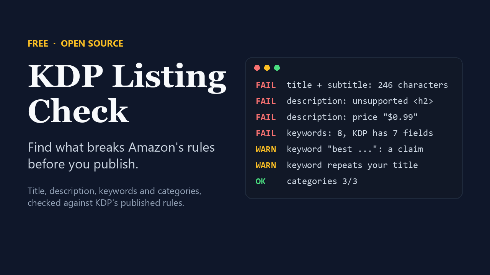

# kdp-listing-check



Check an Amazon KDP book listing against the rules KDP actually publishes,
before KDP does it for you.

It reads your title, subtitle, description, seven keywords and categories and
reports what breaks a rule, with a link to the KDP help page for each finding.
It is a small Python script with no dependencies, packaged as an
[Agent Skill](https://agentskills.io) so an AI assistant can run it, explain
the findings and fix the listing with you.

```
$ python scripts/check_listing.py examples/bad.json

FAIL  title: Title + subtitle is 246 characters; must be fewer than 200.
FAIL  description: Unsupported HTML: <h2>. Supported: b, br, em, h4, h5, h6, i, li, ol, p, u, ul.
FAIL  description: Website address: "www.maraellison.com".
FAIL  description: Asks for a review: "leave a review".
FAIL  description: Price information: "$0.99".
FAIL  keywords: 8 keywords; KDP has 7 fields.
WARN  keyword "best historical mystery book": Subjective claim: best.
WARN  keyword "kindle unlimited mystery": Amazon program name: kindle unlimited, kindle.
...
Counts: title+subtitle 246/199 | description 483/4,000 | keywords 8/7 | categories 4/3
```

## What it checks

| Field | Checks |
|---|---|
| Title, subtitle, series | Combined length under 200 characters; placeholders; punctuation-only; HTML; sales-rank words ("bestselling"); promotional words; repeated generic words; titles over 60 characters |
| Description | 4,000-character limit with HTML counted; unsupported HTML tags; lists without `<li>`; stray angle brackets; URLs, emails, phone numbers; emoji; review requests; reviews and ratings; prices; time-sensitive wording; keyword lists |
| Keywords | More than seven; HTML; quotation marks; sales-rank and promotional words; subjective claims; time-sensitive words and years; "book" and "novel"; Amazon program names; words already in your title, author or categories, including plurals and possessives; spacing, case and plural variants of each other; one word spread across more than two keywords |
| Categories | More than three |

`FAIL` is a mechanical certainty, like a count or a URL. `WARN` is a word match
that needs a person to read it: "free" in the title *Free Fall* is fine.

The rules come from three KDP help pages, checked on 11 November 2026:
[Metadata Guidelines for Books](https://kdp.amazon.com/en_US/help/topic/G201097560),
[Make Your Book More Discoverable with Keywords](https://kdp.amazon.com/en_US/help/topic/G201298500) and
[Write a Book Description](https://kdp.amazon.com/en_US/help/topic/G201189630).
KDP can change them. If a finding looks wrong, the linked page wins.

## What it does not do

- It has no Amazon search data. It cannot tell you which keywords shoppers type or whether your book will rank.
- It cannot tell whether a keyword names another author or a brand you do not own, or whether your categories fit your book. Those need a person.
- Passing every check does not guarantee KDP accepts the listing.

## Use it without any AI

You need Python 3.8 or later.

1. Copy `examples/good.json`, rename it `book.json`, and replace the contents with your listing. Paste the description exactly as it is in KDP, HTML included.
2. Run `python scripts/check_listing.py book.json`.

To check a shorter blurb for a promotion site:

```
python scripts/check_listing.py count blurb.txt --max-words 150
```

## Use it with an AI assistant

**Assistants that support Agent Skills** (Claude Code, Claude, Gemini CLI,
Codex and others): add this folder as a skill, then ask "check my KDP listing"
and paste your listing. In Claude Code the folder goes in
`~/.claude/skills/kdp-listing-check/`. For other assistants, see their
documentation for where skills are installed.

**Assistants without skills support** (for example a ChatGPT project): upload
`scripts/check_listing.py`, paste the contents of `SKILL.md` as the
instructions, then paste your listing.

Tested with Claude Code. The other routes follow each product's documented
skill format but have not been tested by the author; please open an issue if
one does not work.

## Tests

```
python scripts/test_check_listing.py
```

## Want the whole launch done?

This checker is the free part of **Book Launch Kit**, a set of workflows that
writes the blurb from your manuscript, builds the seven keywords, drafts your
author bio and series page, and prepares launch emails and promo copy, all
checked by this script: https://xixlabs.gumroad.com/l/book-launch-kit

The checker is also on Gumroad, pay what you want: https://xixlabs.gumroad.com/l/kdp-listing-check

## License

MIT. See `LICENSE`.
